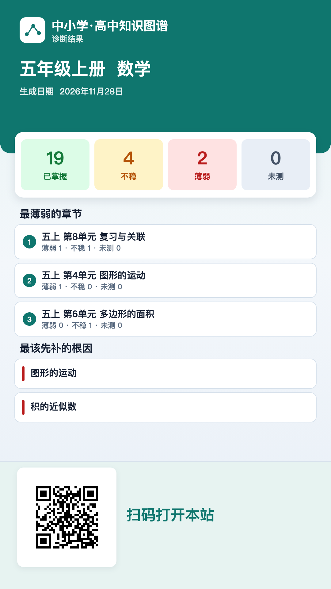
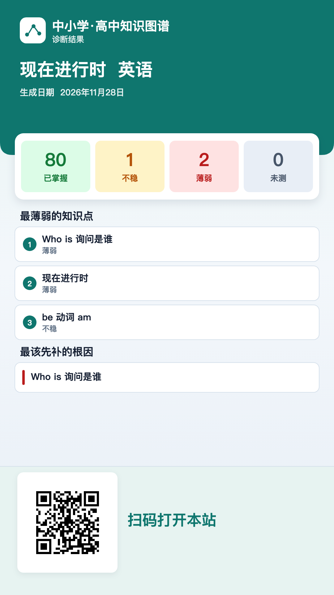
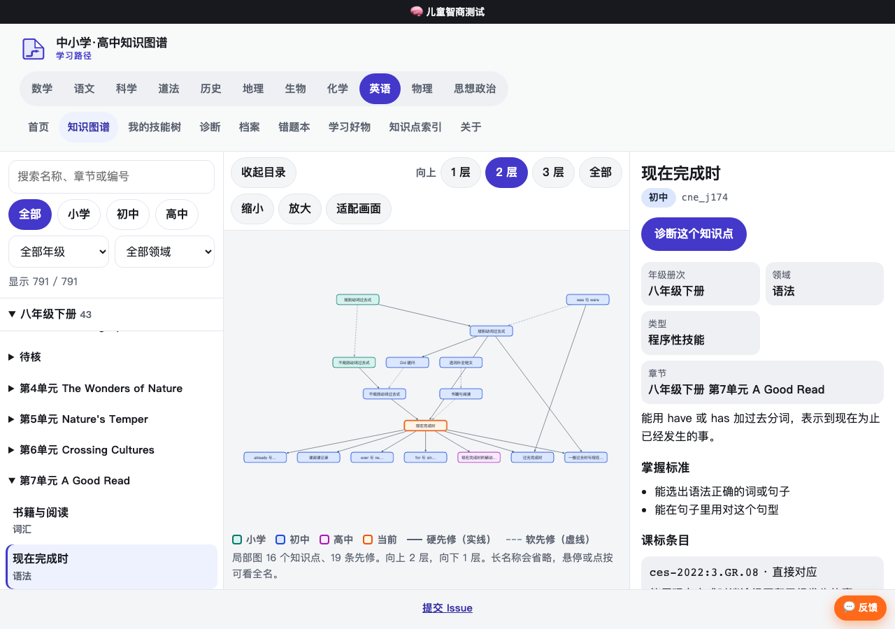
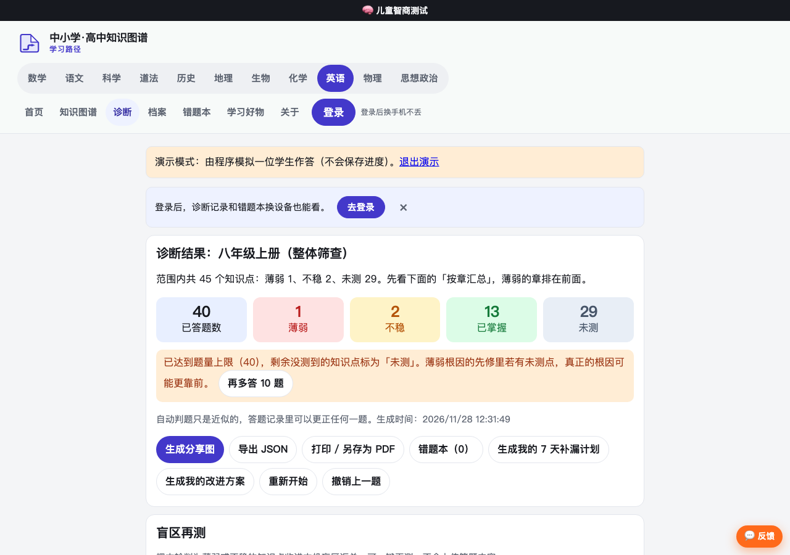
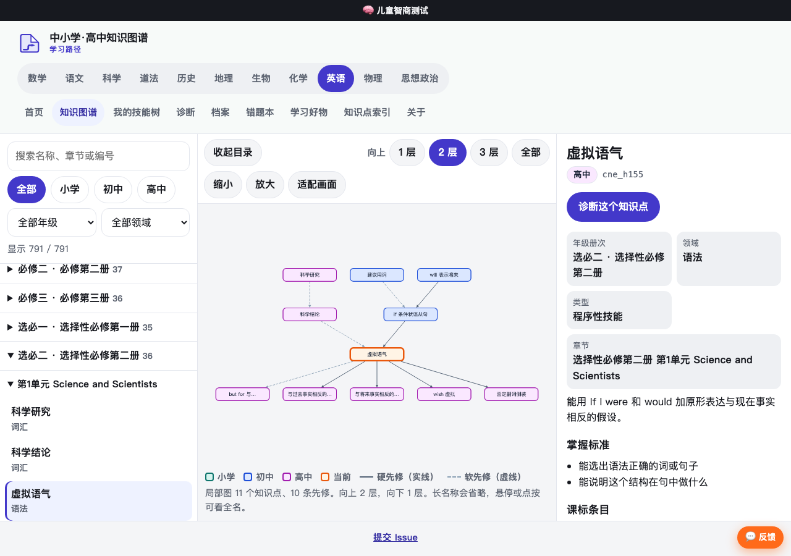
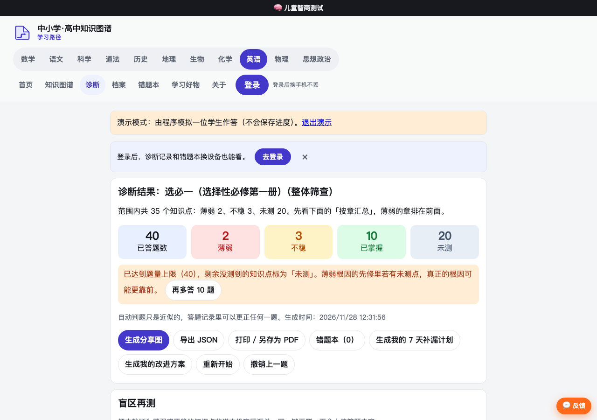
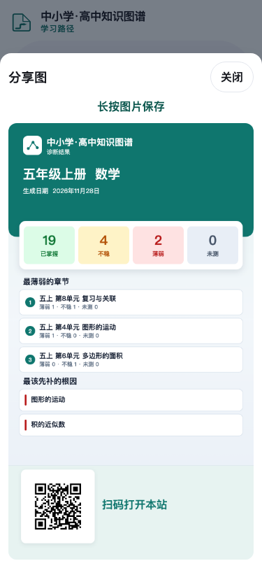

# 线上站点功能与部署说明（存档）

本文件原载于仓库 README，记录线上站点 [math.pansgo.com](https://math.pansgo.com/) 的功能与 URL 约定、后续建议与部署说明。站点源码在私有仓维护，本仓只发布数据与数据工具链。

## 线上站点功能说明

线上站点 [math.pansgo.com](https://math.pansgo.com/) 由私有仓的网站源码构建，构建前会同步本仓 `data/`；页面源码不在本仓，本仓也不提供本地预览。下面记录站点的功能与 URL 约定，数据变动时可对照。

三个页面共用同一套配色（柔和青绿主色，小学青绿、初中蓝、高中品红三种辅助色，跟随系统深色模式）和顶部导航：数学 / 英语、首页、知识图谱、诊断、关于（GitHub）。图形库和二维码库随站点本地分发，页面不从外网 CDN 加载脚本、样式或字体。旧链接 `#cnm_219`、`#cnm_p001`、`#cnm_ext_002` 写在网站根路径上时，会转到知识图谱的同一哈希。`#cne_…` 转到 `explore/?subject=english#cne_…`。`#cnh_…` 转到 `explore/?subject=history#cnh_…`。`#cng_…` 转到 `explore/?subject=geography#cng_…`。`#cnb_…` 转到 `explore/?subject=biology#cnb_…`。`#cnk_…` 转到 `explore/?subject=chemistry#cnk_…`。`#cnc_…`（含小学 `cnc_p`、初中 `cnc_j` 和高中 `cnc_h`）转到 `explore/?subject=chinese#…`。

**首页**：一句话介绍；三步（选知识点 → 自适应答题 → 找到根因和学习路径）；四张统计卡（知识点、先修边、题目、课标条目，打开时按当前学科从数据文件计数，不写死；默认是数学）；「开始诊断」「浏览知识图谱」；数学是一至九年级入口，以及高一（必修第一册）、高二（必修第二册）、选必一、选必二、选必三（链到 `explore/?grade=`）。高中卡片不写「上 / 下」。英语首页是三年级到高中（文案写「英语：三年级到高中」），链到 `explore/?subject=english&grade=`。九年级英语卡片写「全一册」。高中英语卡片是必修一（必修第一册）到必修三，以及选必一（选择性必修第一册）到选必四，不写「高一」到「高四」，也不写「上 / 下」。数学首页仍是 14 张卡片，统计卡默认只计数学。历史首页是七至九年级（文案写「历史：初中七至九年级 · 统编版」），链到 `explore/?subject=history&grade=`，不出现小学和高中卡片。地理首页是七至八年级（文案写「地理：初中七至八年级 · 人教版」），链到 `explore/?subject=geography&grade=`，不出现小学、九年级和高中卡片。生物首页是七至八年级（文案写「生物：初中七至八年级 · 人教版」），链到 `explore/?subject=biology&grade=`，不出现小学、九年级和高中卡片。化学首页是九年级上、下册、必修第一、二册和选择性必修第一、二、三册（文案写「化学：初中九年级 · 高中必修第一、二册和选择性必修第一、二、三册 · 人教版」），链到 `explore/?subject=chemistry&grade=`，不出现小学和七八年级卡片；高中卡片写「必修一」「必修二」「选必一」「选必二」「选必三」，不写「十年级」「十一年级」「十二年级」「十三年级」「十四年级」「必修三」或「高一」「高二」。语文首页是一至九年级，以及高中必修上、必修下、选必上、选必中、选必下（文案写「语文：小学一至六年级 · 初中七至九年级 · 高中必修上、下与选必上、中、下 · 统编版」），链到 `explore/?subject=chinese&grade=`，小学和初中上下册都有，高中卡片不写「高一」或「必修一」。顶部「儿童智商测试」横幅、首页卡片和诊断结果页入口不随学科改变。

**知识图谱**：左侧搜索，以及学段（全部 / 小学 / 初中 / 高中）/ 年级 / 领域筛选，结果按年级·册·章折叠。英语页的学段是全部 / 小学 / 初中 / 高中，年级从三年级到九年级，再加上必修第一册到必修第三册、选择性必修第一册到第四册（不出现「高一」）。领域是语音、词汇、语法、日常表达、读写。选「小学」时清掉初中和高中，选「初中」时清掉小学和高中，选「高中」时只留必修和选择性必修。语文页的学段是全部 / 小学 / 初中 / 高中，年级从一年级到九年级，再加上必修上、必修下、选必上、选必中、选必下（不写成必修一或高一）；领域在拼音、识字写字、词语、句子、阅读理解、古诗文积累、习作基础之外，还有文言文阅读和名著阅读。手机上目录收在顶部抽屉里。中间用 Cytoscape + dagre 只画**当前知识点的局部图**：默认向上 2 层先修（可改 1 / 2 / 3 层或全部祖先），向下 1 层。硬先修实线、软先修虚线，小学、初中、高中节点颜色不同（图例里写明），点节点即可换选中项，可缩放、拖动和「适配画面」。选「全部」时如果超过 40 个点，会先按年级收起，点「共 N 个，点此展开全部」再画每一个点，并对准当前知识点（避免缩成无法辨认的全图）。不会默认铺开全部知识点。名称过长在图上省略，悬停或点按可看全名。右侧（窄屏在图下方）是详情：名称、年级册章、领域、类型、描述、掌握标准、课标条目、样题（答案折叠）、先修列表，以及「被哪些知识点依赖」。大按钮「诊断这个知识点」进入 `diagnose/?target=<id>`；英语会带上 `subject=english`。

**诊断**：开始页先按学段筛选并搜索，册章列表仍在，但默认折叠。数学按年级整体诊断包含一至九年级，以及高一、高二、选必一、选必二、选必三。高中不提供上下册：必修两册的范围按钮写「必修整册」，选择性必修写「整册」。URL 用 `grade=高一`、`grade=高二`、`grade=选必二`（也接受 `高一必修`、`选择性必修第二册` 这类写法）。英语是 `?subject=english`，年级从三年级到九年级，再加上必修一到必修三、选必一到选必四。整册例如 `grade=四上`、`grade=八上`、`grade=选必一`（也接受 `选择性必修第一册`、`必修第一册`）。九年级英语只有全一册，范围按钮是「全一册」，URL 用 `grade=九全`。高中英语不提供上下册：必修三册的范围按钮是「必修整册」，选择性必修是「整册」。不带 `subject` 时 `grade=必修一` 或 `选择性必修第四册` 不会选到数学。语文是 `?subject=chinese`，年级从一年级到九年级，再加上必修上、必修下、选必上、选必中、选必下，上下册都有，学段是全部 / 小学 / 初中 / 高中。整册例如 `grade=一上`、`grade=七上`、`grade=必修上`。诊断进度仍用 `cncDiagnose.session.v2`，小学未完成的会话可以继续。数学和英语的诊断进度分开存在本机（`cnmDiagnose.session.v2` 与 `cneDiagnose.session.v2`），题量设置仍共用。答题卡片和选项加大（触控不小于 44px）。结果页把根因、不稳和学习路径分成卡片。路径图用与知识图谱相同的 Cytoscape：小学 / 初中 / 高中分色，硬先修实线，软先修虚线，薄弱根因红框标出；文字版路径列表仍在。导出 JSON 和打印保留。结果页可以「生成分享图」：在浏览器里用 canvas 画一张 1080×1920 的竖图，写上站名、学科和诊断范围、已掌握 / 不稳 / 薄弱 / 未测、最薄弱的 2–3 章或知识点、1–2 个根因和日期。底部二维码指向 `https://math.pansgo.com/?from=share`，旁边是「扫码打开本站」。图上没有孩子姓名，也不涉及付费。桌面端弹层里下载，手机端长按图片保存。二维码用 qrcode-generator 2.0.4（MIT）在浏览器本地绘制。图例仍是小学、初中、高中三色，选择性必修和必修同用高中色；英语页同样保留这三色，高中英语用高中色。分享图写上学科（英语）和诊断范围（例如选必一），不把英语册次写成高一。

## 后续建议

1. 请小学、初中和高中数学教师先审先修边（尤其是 hard 边、初中→小学的 45 条、高中必修跨学段的 54 条、选择性必修跨模块的 46 条），并用教材实物或人教社官方目录核对九下、高中五册，以及上表里所有标了「非官方、待核」的小学册次（特别是二年级下册）。高中必修第二册是否应改标到高一下、选择性必修的 grade 12–14 是否要改，也请教师定。英语请同时核对 PEP、Go for it! 和高中七册的单元目录，以及高中英语指向初中的 22 条先修。
2. 请课程专家审核 `standards` 映射（尤其 inferred，以及第一至三学段尚未与教育部 PDF 逐页核对的条文），并考虑为仍无对应知识点的课标条款补点。
3. 用真实学生答题数据校准诊断题与先修强度。

## 站点部署

生产站点：https://math.pansgo.com/ （备用 https://cn-math-taxonomy.pages.dev/）。站点由私有仓的网站源码构建并部署到 Cloudflare Pages；本仓不含部署脚本，也不部署。
